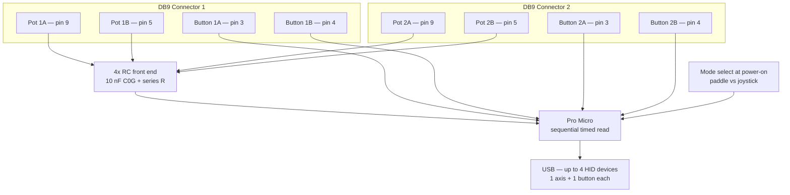
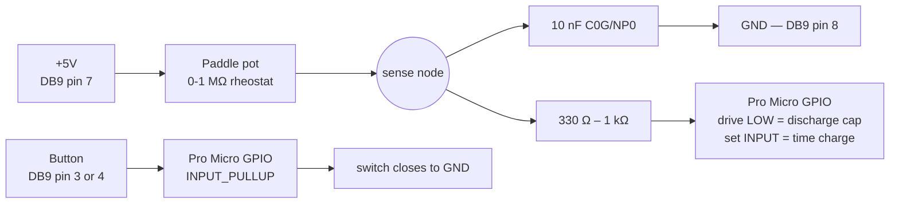

# AtariStick — Paddle Support Design Note

Status: **planned, not built.** This is a design sketch for adding paddle support
later. Nothing here is implemented, no hardware exists, and the only paddle on
hand is a single bench sample — so treat any component value below as a starting
point to be designed *tolerant of*, not a characterized result. A direction
**has** been chosen — see Committed plan: both connectors, 4 paddles, RC timing.

## Goal

Read Atari/C64 paddles on the existing dual-connector hardware and present each
paddle to the host as a USB HID device (1 axis + 1 button). Atari and C64
paddles are electrically identical on the pins that matter (verified — see
References), so **one design serves both, with no mode switch.**

## Verified facts (datasheet-backed)

Per control port, paddles use:

- **Pin 9** — paddle A potentiometer
- **Pin 5** — paddle B potentiometer
- **Pin 3** — paddle A button (the joystick LEFT line)
- **Pin 4** — paddle B button (the joystick RIGHT line)
- **Pin 7** — +5V (required for paddles)
- **Pin 8** — GND

Pots are 1 MΩ linear taper. Atari and C64 agree on all of the above; the only
C64-specific quirk (its paddle buttons route through the keyboard matrix) is
internal to the C64 and does not affect this adapter.

## Committed plan — both connectors, 4 paddles, RC timing

**Decision:** wire **both** DB9 connectors for a full paddle pair each — **4 pots
/ 4 buttons total** — and read them with **RC timing (Option B)**, not the ADC
divider. Rationale: timing is value-tolerant (no per-pot resistor to characterize
against a population — see the front-end discussion below), and it is what the
original hardware did. The ADC-divider path (Option A) is retained below as a
documented alternative but is **not** the committed design.

Per pot: one **10 nF C0G/NP0** timing cap + one **330 Ω–1 kΩ** series resistor +
one capture/digital-capable GPIO that both discharges and senses. Per button:
reuse DB9 pin 3 / pin 4 on a GPIO with `INPUT_PULLUP`. So the added BOM is **4
caps + 4 resistors**; everything else is wire + firmware.

Two ceilings shape the firmware:

- **One hardware input-capture (ICP1).** Can't give 4 pots their own capture, so
  **read sequentially** — discharge pot, time the charge, move on. 4 × ~9 ms
  worst case ≈ 36 ms → ~28 Hz per pot. Never charge all 4 at once (cross-channel
  interference).
- **USB endpoints.** CDC (3) + N HID interfaces ≤ 7 endpoints → **4 devices is
  the hard cap.** 4 paddles fills it, so paddles run as a **power-on mode**,
  *not* concurrently with joystick interfaces. (This is a paddle-vs-stick mode
  selection — separate from, and unrelated to, the Atari/C64 compatibility, which
  needs no mode switch.)

### System wiring

### Per-channel RC front end (one of four)

Read cycle per pot: drive the GPIO **LOW** to dump the cap → switch the GPIO to
**INPUT** and start the timer → the pot charges the cap through 0–1 MΩ → when the
pin crosses its threshold, capture the count → that count is the paddle position.
Repeat for the next pot. The series resistor only limits inrush during the
discharge phase; while sensing, the pin is high-impedance so no drop across it.

## Wiring delta (per connector) — committed (RC timing)

| Pin | Now              | For paddles (RC timing)                                  |
|-----|------------------|---------------------------------------------------------|
| 9   | digital (joy)    | pot A → RC front end (10 nF + series R) on a GPIO        |
| 5   | unconnected      | pot B → RC front end on a GPIO — **1 new wire**          |
| 3   | digital LEFT     | button A — reuse, `INPUT_PULLUP`                         |
| 4   | digital RIGHT    | button B — reuse, `INPUT_PULLUP`                         |
| 7   | optional/unwired | **must connect to +5V** (powers the pots)               |
| 8   | GND              | unchanged (cap return + button return)                  |

So the real hardware change per connector is: **bring out pin 5, add the two RC
front ends, and ensure pin 7 (+5V) is connected.** Pins 3/4/9 are already wired;
9 and 5 move off any ADC assumption onto plain timing-capable GPIOs.

### Pin map (Arduino ↔ DB9), committed

Paddle and joystick modes are mutually exclusive (mode select at power-on), so
each DB9 line does double duty on its single Arduino pin. **No input-capture pin
is used — all four pots are read by polled timing** (a tight loop at 16 MHz
resolves well under 1 µs vs charge times of 90 µs–9 ms, so hardware capture buys
nothing here; ICP1 = D4 is also tied to DB9 pin 6, unused by paddles). Pots A
reuse the existing BTN2 lines; pots B need **one new wire each**; buttons reuse
LEFT/RIGHT.

**Connector 1**

| DB9 | Arduino | Joystick mode | Paddle mode |
|-----|---------|---------------|-------------|
| 1 | 0 | UP | — |
| 2 | 1 | DOWN | — |
| 3 | 2 | LEFT | Button A (`INPUT_PULLUP`) |
| 4 | 3 | RIGHT | Button B (`INPUT_PULLUP`) |
| 6 | 4 | BTN1 (fire) | — (D4/ICP1 idle) |
| 9 | 5 | BTN2 | **Pot A** (timed) |
| 5 | **A0 (new wire)** | — | **Pot B** (timed) |
| 7 | VCC | — | +5V to pots |
| 8 | GND | GND | cap + button return |

**Connector 2**

| DB9 | Arduino | Joystick mode | Paddle mode |
|-----|---------|---------------|-------------|
| 1 | 6 | UP | — |
| 2 | 7 | DOWN | — |
| 3 | 8 | LEFT | Button A |
| 4 | 9 | RIGHT | Button B |
| 6 | 10 | BTN1 | — |
| 9 | 16 | BTN2 | **Pot A** (timed) |
| 5 | **A1 (new wire)** | — | **Pot B** (timed) |
| 7 | VCC | — | +5V |
| 8 | GND | GND | return |

Net new wiring: **2 wires** (DB9 pin 5 → A0 / A1). Spare pins: 14, 15, A2, A3.

**⚠ Confirm before trusting this table:** the source only records logical
function → Arduino pin (the `setPin` calls), **not** the physical DB9 → Arduino
wiring. This map *infers* **DB9 pin 9 → Arduino 5 (C1) / 16 (C2)** — i.e. that the
BTN2 line is physically DB9 pin 9. The older note in this doc once claimed pin 9 →
A9 (= D9), which collides with `P2_RIGHT` and was probably wrong — but **trace the
actual wire before building.** Everything downstream depends on this one fact.

Notes:

- **Pots A sit on digital-only pins** (5 = PC6, 16 = PB2): fine for drive-low +
  poll timing, but **not** ADC-capable — so this map forecloses an Option-A
  revival on pots A. Pots B on A0/A1 *are* ADC-capable, keeping that door open.
- **Pin 7 → VCC** is the easy-to-forget one: no pot reads anything without it.

### ADC pin mapping (Option A alternative — superseded by the committed plan)

> The committed design uses RC timing on digital/capture GPIOs, **not** ADC
> channels, so this mapping does not apply to it. Kept for reference in case the
> Option-A divider path is ever revived.

The Pro Micro exposes 9 ADC channels: A0–A3 (= D18–D21) and A6–A10 (= D4, D6,
D8, D9, D10). The dual-joystick sketch already uses D4/D6/D8/D9/D10, so A6–A10
are taken — **only A0–A3 are free.** Map paddle pots to those:

| DB9 pin | Connector 1 | Connector 2 |
|---------|-------------|-------------|
| 9 (paddle A) | A9 (already wired) | re-map — see caveat |
| 5 (paddle B) | **A0** | **A1** |

ADC budget: 2 pots × 2 connectors = 4 channels — fits in A0–A3 with the pin-9
paths, but see the collision caveat.

**Collision caveat:** the pin-9 paddle-A path uses A9 = D9, which the dual sketch
already drives as `P2_RIGHT`. Single connector, no conflict. Dual connector +
paddles must re-map pin 9 off D9 (e.g. to a free A2/A3) — DB9 pin numbers and
Arduino pin numbers are different domains; don't conflate them.

Each pot pin is a 3-way junction, not a single wire: the DB9 pot pin **and** the
external ~1 MΩ pull-down to GND both tie to the ADC pin, with +5V (pin 7) feeding
the pot (see the analog front end below).

## The fiddly part — the analog front end (real design risk)

A paddle is wired as a **2-terminal rheostat** (a variable resistor: +5V → pot →
pin), **not** a 3-terminal voltage divider. The pot pin therefore presents a
*variable resistance*, not directly a *variable voltage* the ADC can read. Two
ways to handle it:

- **Option A — fixed pulldown resistor (simplest).** Add a fixed resistor from
  each pot pin to GND. Pot + resistor form a divider; `analogRead()` reads the
  midpoint. Cheap, then all firmware. A real working build (waitingforfriday,
  below) used **100 kΩ wiper→GND + a 220 nF cap in parallel for smoothing** — note
  that is ~10× lower than a naive "match the 1 MΩ pot" guess, and the smoothing
  cap is not optional in practice. Downside: range/linearity depend on the
  resistor choice vs the pot, and the bottom of the range shifts with pot-to-pot
  variance — documented limitations, not hypothetical (see Prior art below).
- **Option B — RC timing (authentic).** Replicate how SID/POKEY read it: charge
  a capacitor through the pot and time it with a hardware timer. No divider
  resistor, more faithful, but more firmware and timing-critical. **Cap
  dielectric matters here:** the cap value *is* the measurement, so use **C0G/NP0
  ceramic or a film cap (polypropylene/polystyrene), not X7R/X5R class-2
  ceramic** — class-2's voltage coefficient, temp drift, and dielectric
  absorption all corrupt a timing read (nonlinearity, drift, read-to-read
  hysteresis).

#### Why the smoothing cap (Option A) is not optional

The 220 nF cap sits from the ADC node to GND, in parallel with the pull-down. It
does **two** jobs:

1. **Low-pass noise filter.** Pot + cap form an RC low-pass that shunts mains hum,
   switching noise, and scratchy-wiper spikes to ground before they reach the
   ADC's low bits — the visible "kill the last-digit jitter" effect.
2. **Charge reservoir for the ADC sample-and-hold (the real reason).** The AVR ADC
   samples by briefly connecting an internal ~14 pF hold cap to the pin; the
   datasheet wants a **source impedance ≤ ~10 kΩ** for it to settle in the
   sampling window. Our source is the pot — **100 kΩ–1 MΩ**, 10–100× too high — so
   without a local reservoir the hold cap never fully charges and every reading
   comes back low and noisy. The 220 nF cap is a low-impedance pool right at the
   pin that fills the tiny hold cap instantly, making a high-impedance pot legible
   at all. This is why dropping it gives *bad* reads, not merely noisier ones.

**Sizing tradeoff:** bigger cap = smoother but laggier, and the filter constant
τ = R·C uses the *variable* pot as R. At 100 kΩ, τ ≈ 22 ms (fine); near 1 MΩ,
τ ≈ 220 ms (a visibly sluggish paddle). So size the cap small enough not to mush
fast paddle moves at the high-resistance end — the iCode RC build (Prior art)
deliberately keeps filtering light for exactly this reason.

**Cap dielectric:** unlike Option B, here the exact capacitance is irrelevant —
any **ceramic is fine, X7R/X5R class-2 included.** Its voltage/temp coefficients
only affect capacitance *accuracy*, which doesn't matter for a noise-shunt /
reservoir cap. Only requirement: low leakage (a decent ceramic qualifies), since
leakage current would pull the divider node and skew the reading.

#### Option B — concrete BOM (Pro Micro, 16 MHz ATmega32U4)

**Timing capacitor:**

| Spec | Value | Why |
|------|-------|-----|
| Capacitance | **10 nF (0.01 µF)**, marking `103` | Sets charge time across the pot range (math below) |
| Dielectric | **C0G/NP0 ceramic** (or polypropylene film) | Flat, low-DA — the value *is* the measurement. **Not** X7R/X5R/Y5V |
| Temp coefficient | C0G ±30 ppm/°C | Reading must not drift with temperature — the headline spec |
| Dielectric absorption | low (C0G ~0.6%, PP film <0.1%) | Soakage = read-to-read hysteresis after each discharge |
| Tolerance | ±5% (C0G typical) is plenty | Firmware auto-range absorbs absolute value; *stability* is what matters |
| Voltage rating | ≥10 V (50 V common) | Node only swings 0–5 V |

**Why 10 nF.** Charge time to the input threshold is roughly `t ≈ 0.9·R·C`
(logic-high ≈ 3 V on 5 V):

- R ≈ 1 MΩ (knob max) → t ≈ 9 ms → ~100 reads/s per paddle.
- R ≈ 10 kΩ (knob min + wiring) → t ≈ 90 µs → ~1,400 timer ticks at 16 MHz, good
  low-end resolution.

Off-value: **1 nF** shrinks times 10× so stray/wiring capacitance dominates the
low-R end (resolution craters); **100 nF** stretches max charge to ~90 ms so the
read rate drops under ~10 Hz (laggy). 10 nF is the sweet spot for this clock + pot
range.

**Companion parts:**

- **Series resistor ~330 Ω–1 kΩ** between the discharge GPIO and the cap node, to
  limit the inrush spike when the pin sinks the charged cap (POKEY used 1.8 kΩ
  internally for the same reason).
- **Defined threshold:** use **Timer1 input capture (ICP1)** or the **analog
  comparator** (bandgap ref) to timestamp the crossing rather than polling
  `digitalRead()` — the digital `VIH` threshold is loose and temperature-dependent,
  which would give back the precision the C0G bought. Polling works (Apple II did
  it) but is the lower-accuracy path.

Keep the cap physically close to the pin with short leads — at these impedances
stray capacitance is real. Note Option B needs a digital/capture-capable pin per
pot, **not** an ADC channel, so the A0/A9 mapping above is Option-A-specific and
would be re-done for timing.

### Prior art — every original read paddles by RC timing, not by ADC

This is why the paddle is a 2-terminal rheostat: it was always meant to set an RC
time constant, never to output a voltage. None of the originals used an ADC. They
charged a capacitor through the pot and measured the time — exactly Option B.

- **Atari 2600 (TIA).** Ports `INPT0–INPT3` each have a transistor that grounds
  (discharges) the cap; writing bit 7 of `VBLANK` dumps them. Clearing it lets
  the pots recharge the caps, and the 6502 counts **scanlines** until each input
  reads logic 1 — that count is the paddle position. (Stella Programmer's Guide,
  "Dumped Input Ports.")
- **Commodore 64 (SID 6581/8580).** SID does the timing **in hardware** and
  exposes an 8-bit result (0–255) at `$D419` (POTX) / `$D41A` (POTY); software
  just reads a byte after selecting the paddle via CIA#1 port A. The fire buttons
  come back on the joystick-direction lines, not a dedicated pin.
- **Atari 8-bit / 5200 (POKEY).** Same scheme, 8 pot lines. Writing `POTGO`
  discharges the read caps and sets `ALLPOT=$FF`; each `POT0–POT7` counts up
  until its Schmitt trigger flips (~2 V), then its `ALLPOT` bit clears to signal
  "stable." POKEY's internal front end is a **1800 Ω series R + 0.047 µF cap**
  against the controller's **0.5–1 MΩ** pot; values run 0–228. (POKEY datasheet.)
- **Apple II (558 quad timer + software).** No smart chip: each pot is the timing
  resistor of a 558 one-shot with a **0.022 µF** cap (pots ~150 kΩ). `PREAD`
  strobes `PTRIG`, then polls `PADDL0,X` in a loop (~11 µs/count) until the
  output drops. CPU-bound — reading paddles literally stole game cycles.

Throughline: all four measured **time, not voltage**, which is naturally
value-tolerant — a 0.6 MΩ or 1.3 MΩ pot just yields a different count, no resistor
to re-size. SID/POKEY did it in silicon; the 2600 and Apple II did it in 6502
loops. On the Pro Micro, Option B reproduces this with a GPIO to discharge the cap
plus a hardware timer / input-capture to measure the charge time.

### Prior art — paddles on modern microcontrollers with ADCs

Both options have been built on modern MCUs; the split is instructive.

**Option A (ADC + divider) in the wild:**

- **C64 VICE Front-End (waitingforfriday)** — closest match. A PIC18F4550 ADC.
  They hit the exact rheostat trap first ("only two pins connected → variable
  resistor, not a divider → the ADC sees 5 V regardless"), then fixed it with a
  **100 kΩ resistor wiper→GND plus a 220 nF cap in parallel** to smooth jitter.
  This is the concrete recipe to start from — and note 100 kΩ ≠ the 1 MΩ
  ballpark, and the smoothing cap is load-bearing.
- **chr15m/c64-paddle-midi-controller** — Teensy 2.0 ADC → USB MIDI. Same divider
  idea, different chip.
- **diyelectromusic** — several Arduino `analogRead()` paddle builds (Atari MIDI
  paddles, a 2600 controller shield).

**Option B (RC timing) in the wild:**

- **iCode "Ultimate" adapter** (commercial) — explicitly RC timing, *not* ADC: a
  22 nF cap on a 150 MHz MCU, four scans per frame-window, multi-sample averaging
  to cancel the 1–2 count jitter. The product whose whole selling point is paddle
  *smoothness* chose RC timing — a data point for B being the higher-fidelity path.

**Same MCU as this project:**

- **tebl/C64-Joystick-Adapter** — an **Arduino Pro Micro** adapter whose
  JoyConverter firmware already supports paddles (mapped to X/Y + a fire button
  each, two paddles per port). Proves paddles-on-Pro-Micro is feasible on our
  exact chip; unfortunately its public docs don't publish the analog front end,
  so it confirms the path but not the component values.

**The documented limitation:** builders state the ADC-divider method's two known
downsides outright — *"1) non-linear range 2) non-fixed minimal value as the pot
and pull-down resistor vary from piece to piece."* That is the population-vs-sample
problem as a known property of Option A, not a worry we invented. It is also why
the smoothness-focused commercial unit went with B.

**Recommendation:** start with Option A, but **size for the population, not the
sample.** Don't pick the pull-down to fit one measured pot — pick it for a
plausible worst-case range (e.g. 0.5–1.5 MΩ) so any 40-year-old pot lands
somewhere usable on the ADC scale, then let firmware auto-range absorb the rest.
A single bench paddle can confirm the *path works*; it cannot authorize a
production component value. If worst-case sizing can't give acceptable resolution
across that range, switch to Option B — RC timing is value-independent by
construction, it sidesteps the whole sizing question, and it is what the original
hardware actually did (see Prior art above).

## Firmware

- New `AtariPaddle : public PluggableUSBModule` class, mirroring `AtariStick`
  (own HID interface → own device). Descriptor: one absolute axis + one button.
- Axis resolution / range: paddles are commonly read as 0–255. Confirm what
  VirtualC64 expects for a paddle axis before fixing the descriptor (TBD — do
  not assume the joystick's −127..127).
- **Read by RC timing (committed):** per pot, drive the GPIO LOW to discharge,
  switch to INPUT, time the charge to threshold (Timer1 capture preferred over
  polling `digitalRead()` for a stable threshold), and use the count as position.
  Read the 4 pots **sequentially**, one charge cycle at a time — never concurrently.
- **Auto-range:** track observed min/max charge counts and map to the full axis —
  self-calibrating, absorbs pot value, drift, and per-pot variance with no user
  config. (This is what makes timing value-tolerant.)
- Button = `digitalRead()` on pin 3 (or 4), `INPUT_PULLUP`, via the existing
  `Debouncer`.
- **Mode select at power-on** (paddle vs joystick) — 4 paddles exhaust the USB
  endpoint budget, so they cannot enumerate alongside stick interfaces.
- Reuse the existing `setPin` / `update` patterns where they fit.

## HID enumeration

Each paddle = its own interface = its own device (paddle 1, paddle 2, …),
consistent with the dual-stick model and what emulators expect. A full paddle
*pair* on one connector = 2 devices.

Endpoint budget: CDC (3) + N stick/paddle interfaces ≤ 7 usable endpoints, so
about **4 devices total** before running out — document the cap.

## Test protocol (hardware gate)

1. Measure the bench paddle with a multimeter — confirm it is a passive pot, find
   the wiper pin and resistance sweep. **Gate: must sweep smoothly.** This
   identifies the part and sanity-checks it; it does **not** characterize the
   population — one aged pot is not a sample size.
2. Wire pin 9 + pin 7 + one RC front end (10 nF C0G + series R) on one connector;
   flash a one-paddle timing test sketch.
3. Use an IOKit HID monitor (as in the joystick tests) to confirm the axis
   sweeps the full range as the knob turns, and the button registers.
4. Confirm in VirtualC64 with a paddle-aware game (Pong/Arkanoid-style) that the
   knob actually controls play.
5. Only then: add pot B (pin 5), the second connector's two pots, the mode
   select, and commit all four channels.

**Scope of one paddle:** the single bench unit validates the pin-9 (pot A)
path end to end — wiring, timing read, axis, button. That is all it proves. RC
timing is value-tolerant by construction, so unlike the Option-A divider it does
not need characterizing a fixed resistor against a population — but still bench
the cap/threshold behavior on the real unit before scaling to four, and confirm
auto-range tracks correctly across the full sweep.

## Out of scope

Firmware autofire, Amiga/ST mouse, and the C64 1351 proportional mouse were all
considered and dropped (modern USB equivalents exist, or the wiring/encoding is
incompatible with this all-digital adapter).

## References

- [Atari joystick port — Wikipedia](https://en.wikipedia.org/wiki/Atari_joystick_port)
- [Control Port — C64-Wiki](https://www.c64-wiki.com/wiki/Control_Port)

Paddle pinout (pins 3/4/5/7/8/9, pair shares one DE-9):

- [Atari Paddle pinout — pinouts.ru](https://old.pinouts.ru/InputCables/atari_paddle_pinout.shtml)
- [CX30 Paddle — Best Electronics](https://www.best-electronics-ca.com/cx30_paddle.htm)
- [DE-9 Paddle — Individual Computers wiki](https://wiki.icomp.de/wiki/DE-9_Paddle)
- [The Industry-Standard Atari-Style Controller — Nerdly Pleasures](http://nerdlypleasures.blogspot.com/2013/01/the-industry-standard-atari-style.html)

Prior-art / RC-timing sources (per the analog front end section):

- Atari 2600 TIA dumped input ports — [Stella Programmer's Guide (Steve Wright, 1979)](https://alienbill.com/2600/101/docs/stella.html)
- C64 SID paddle registers POTX/POTY — [SID — C64-Wiki](https://www.c64-wiki.com/wiki/SID) and [C64 Programmer's Reference Guide, Game Ports](https://www.devili.iki.fi/Computers/Commodore/C64/Programmers_Reference/Chapter_6/page_346.html)
- POKEY POTGO/ALLPOT and front-end values — [Atari POKEY datasheet](http://krap.pl/mirrorz/atari/homepage.ntlworld.com/kryten_droid/Atari/800XL/atari_hw/pokey.htm) and [POKEY — Wikipedia](https://en.wikipedia.org/wiki/POKEY)
- Apple II 558 timer + PREAD — [Apple IIe Technical Note: Paddle Circuits](http://www.apple2.org.za/gswv/USA2WUG/IIe.Dev.TechNotes/APPLE2E6.TXT)

Modern-MCU prior art (per the analog front end section):

- ADC + 100 kΩ/220 nF divider on a PIC — [C64 VICE Front-End — waitingforfriday](https://www.waitingforfriday.com/?p=470)
- Teensy 2.0 ADC paddle→USB MIDI — [chr15m/c64-paddle-midi-controller](https://github.com/chr15m/c64-paddle-midi-controller)
- Arduino analogRead paddle builds — [diyelectromusic — Arduino MIDI Atari Paddles](https://diyelectromusic.com/2025/06/23/arduino-midi-atari-paddles/)
- RC timing on a fast MCU (commercial) — [iCode — Demystifying Atari Paddle Jitter](https://www.icode.com/demystifying-atari-paddle-jitter-how-the-icode-ultimate-adapter-delivers-the-smoothest-paddle-experience/)
- Paddles on an Arduino Pro Micro (same MCU) — [tebl/C64-Joystick-Adapter](https://github.com/tebl/C64-Joystick-Adapter)
- ADC-divider non-linearity / piece-to-piece variance noted by builders — [Atari-Forum DIY adapter thread](https://www.atari-forum.com/viewtopic.php?t=37582&start=25)
